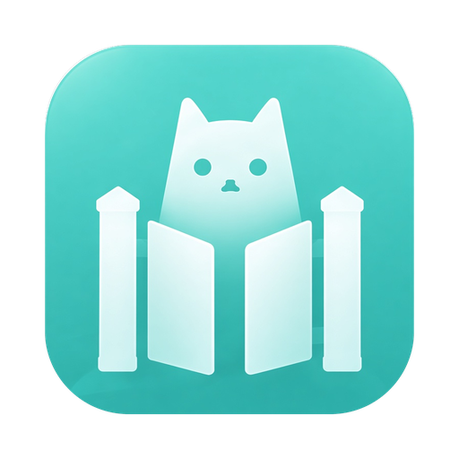
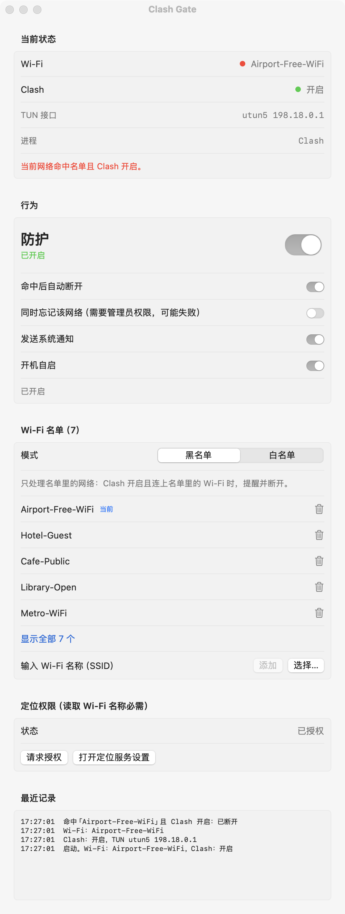
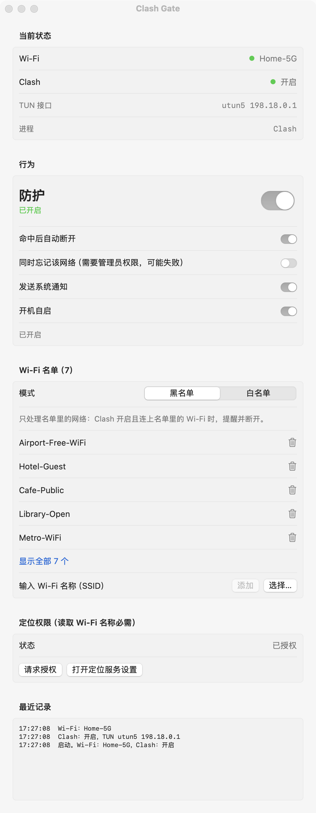
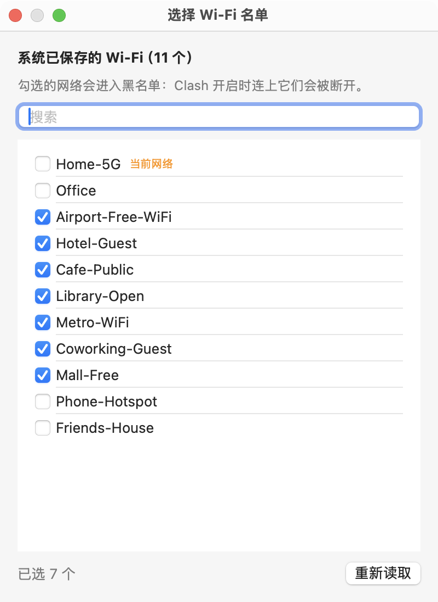
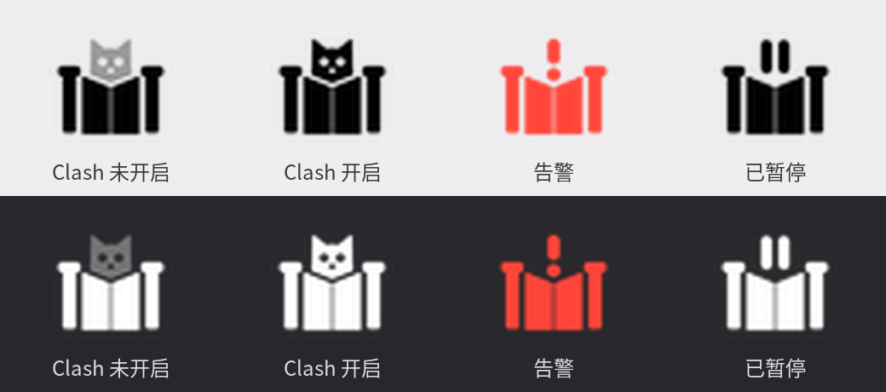

# Clash Gate

<p align="center"></p>

macOS 菜单栏小工具：**Clash 开启时，如果当前连接的 Wi-Fi 命中名单，就提醒并立即断开。**

适合这样的场景：在机场、酒店、咖啡馆的公共 Wi-Fi 上，或者公司网络里，你不希望 Clash 开着的时候设备连上它们。

- 原生 Swift（AppKit 菜单栏加 SwiftUI 设置窗口），事件驱动，空闲时几乎不占 CPU。
- 只需要 Command Line Tools，不需要安装 Xcode。
- 黑名单（默认）或白名单，名单可以手动输入，也可以从系统已保存的 Wi-Fi 里多选。
- 支持 Clash 的系统代理模式和 TUN 模式。
- 菜单栏图标用四种状态显示：Clash 未开启、Clash 开启、告警、已暂停。
- 可以申请或取消开机自启。
- 不联网，不上传任何数据。

## 截图

| 命中名单（告警） | 一切正常 |
| --- | --- |
|  |  |

设置窗口从上到下依次是：当前状态、行为（带一个大号总开关）、Wi-Fi 名单（超过 5 个会自动折叠）、定位权限、最近记录。上图里的网络名都是示例数据。

**从已知网络中选择**（点名单旁边的“选择…”）：



**菜单栏图标**（浅色和深色菜单栏下各四种状态）：



菜单栏点击图标会显示：当前 Wi-Fi、Clash 状态、名单模式和数量，以及“启用防护”、“加入名单”（当前网络或已知网络）、“设置…”、“开机自启”和“退出”。

## 安装

要求 macOS 13 或更新版本，已安装 Command Line Tools：

```bash
xcode-select --install   # 已经装过就跳过
git clone https://github.com/JesseZhang97/clash-ssid-guard.git
cd clash-ssid-guard
./install.sh             # 构建、安装到 ~/Applications 并启动
```

只构建不安装：`./build.sh`，产物在 `build/ClashGate.app`。

首次启动：

1. 弹出的定位权限请选“允许”。macOS 要读到 Wi-Fi 名称就必须有定位权限，否则应用只知道“已连接”，无法判断。
2. 在设置窗口里添加要处理的网络，或点“选择…”从已保存的网络里多选。
3. 需要的话打开“开机自启”。

## 使用

- **黑名单**（默认）：只处理名单里的网络。Clash 开启并连上名单里的 Wi-Fi 时，提醒并断开。
- **白名单**：只放行名单里的网络。Clash 开启并连上不在名单里的 Wi-Fi 时，提醒并断开。
- **命中后自动断开**：关掉后只提醒，不断开。
- **同时忘记该网络**：断开后再删除系统里保存的这个网络，防止自动重连。需要管理员权限，可能失败。
- **防护总开关**：关掉后图标变成暂停状态，不再处理任何网络。

## 判断逻辑

- **Clash 开启** = 系统代理指向本机（127.0.0.1 或 localhost），或系统 PAC 地址指向本机，或存在 Clash 的 TUN 接口（utun，地址在 198.18.0.0/15）。只运行 Clash 但没有接管流量，只显示“已运行，未接管流量”，不触发。
- **命中** = 黑名单模式下 SSID 在名单里，或白名单模式下 SSID 不在名单里。
- **动作** = 系统通知；开启“自动断开”时调用 CoreWLAN 的 `disassociate()`。
- 60 秒内同一网络被系统重连 4 次，会暂停处理 60 秒并通知，避免无限循环。

更多实现细节见 [docs/DESIGN.md](docs/DESIGN.md)。

## 限制

- 无法在连接前拦截，只能连上后立刻断开，断开前设备可能已经拿到 IP。
- 读取 SSID 需要定位权限。授权被拒绝时，应用能看到“已连接”，但读不到名称，也就无法判断。
- 默认 ad-hoc 签名，重新构建后系统可能要求重新授权定位和登录项。可以用 `SIGN_ID="Apple Development: xxx" ./build.sh` 指定开发者证书，让授权保持稳定。
- 本机系统代理视为 Clash 开启，不区分是不是 Clash。
- 通知和断开 Wi-Fi 的实际效果取决于系统设置（通知权限、Wi-Fi 自动加入）。

## 文件位置

- 配置：`~/Library/Application Support/ClashGate/config.json`
- 日志：`~/Library/Logs/ClashGate.log`

从旧名 Clash SSID Guard 升级时，首次启动会自动迁移旧配置。

## 调试

```bash
~/Applications/ClashGate.app/Contents/MacOS/ClashGate --status
```

打印 Clash 和 Wi-Fi 的当前状态后退出。

## 演示模式

README 里的截图由演示模式生成。它使用示例网络名，不读写真实配置和日志，也不会断开任何网络：

```bash
CLASHGATE_DEMO=alert CLASHGATE_DEMO_OUT=/tmp/shots build/ClashGate.app/Contents/MacOS/ClashGate
```

`CLASHGATE_DEMO` 取 `alert`（命中）或 `ok`（正常）。窗口画面会保存成 PNG 到 `CLASHGATE_DEMO_OUT`，然后应用退出。
